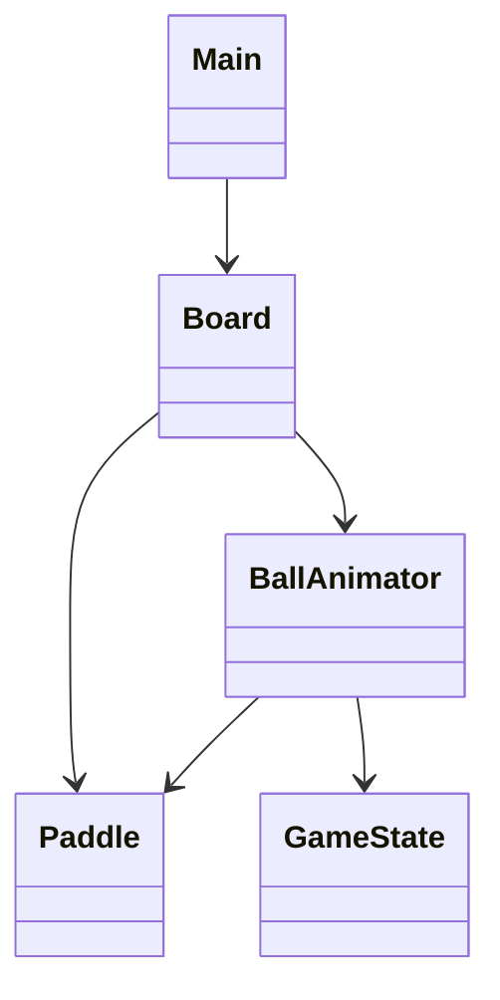

# Reporte breve de refactorización

## Cambios realizados

Partí del proyecto que movía una pelota roja. Ya tenía teclas para pausar,
acelerar, desacelerar y cambiar tamaño. El movimiento antes dependía de un
hilo y el repintado de otro; además, la pausa seguía usando `Thread.sleep()`.

Sustituí ambos hilos por un `Timer`. Su evento ocurre en el EDT de Swing y
permite detener la actualización al pausar, sin revisar repetidamente el
estado. Al cerrar la ventana también detengo el Timer.

Agregué una raqueta y cambié el cálculo de colisiones para considerar el
tamaño de la pelota. La posición se guarda con `double` y se revisa el
siguiente movimiento para evitar atravesar una raqueta delgada.

## Separación de responsabilidades

- `Main`: abre la ventana.
- `Board`: muestra el juego, interpreta teclas y utiliza el Timer.
- `BallAnimator`: mueve la pelota, detecta colisiones y guarda el estado.
- `Paddle`: representa y mueve la raqueta.
- `GameState`: enumera los estados del juego.

## UML sencillo

## Decisiones y limitaciones

- **EDT:** modificar Swing desde otro hilo puede producir inconsistencias.
- **`yield()` / `sleep()`:** no suspenden realmente un ciclo de sondeo; Timer
  puede detenerse y reanudarse sin seguir despertando.
- **Timer:** es sencillo para un juego 2D pequeño; una aplicación con física
  compleja o cálculos largos necesitaría otro diseño.
- **Pasos grandes:** pueden saltarse una colisión; comprobar el cruce y usar
  pasos pequeños reduce el riesgo.
- **Separar lógica y dibujo:** hace posible probar rebotes sin abrir Swing.
- **Pruebas:** permiten comprobar si otro cambio rompe comportamientos anteriores.
- **Ampliación:** para dos jugadores, marcador o niveles habría que agregar
  controles, puntajes y reglas nuevas; `Board` concentra algunas tareas y
  podría separarse más adelante si el proyecto creciera.

No se agregaron efectos, sonido, multijugador ni un sistema de niveles.
La implementación busca cubrir la práctica con el menor número de clases
posible y sin introducir una arquitectura MVC completa.
